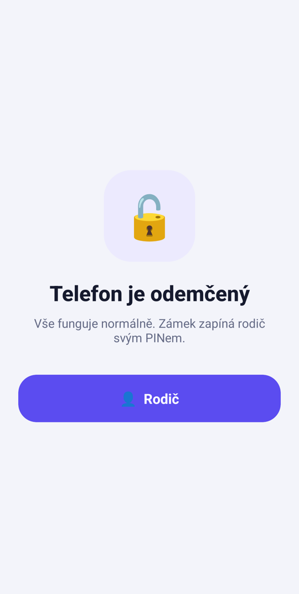
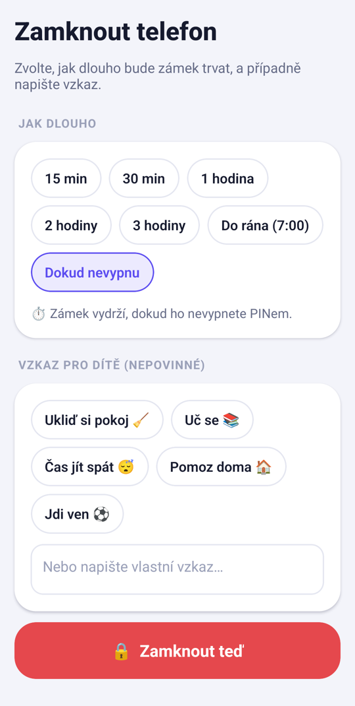

<div align="center">


# Rodičovský zámek

**Místo zabavení telefonu ho jen zamkněte.**
Dítě může volat, psát SMS a používat základní aplikace. Hry, videa a sociální sítě zůstanou zavřené, dokud zámek nevypnete PINem nebo nevyprší čas.

[](https://github.com/evzenloveczen123/rodicovsky-zamek/actions/workflows/ci.yml)
[](LICENSE)


[**⬇️ Stáhnout APK**](https://github.com/evzenloveczen123/rodicovsky-zamek/releases/latest) · [🌐 Web aplikace](https://evzenloveczen123.github.io/rodicovsky-zamek/) · [Jak to funguje](#jak-to-funguje) · [Vývoj](#vývoj) · [English](#english)

</div>

---

<p align="center">
  
  &nbsp;&nbsp;
  
</p>

## Funkce

| | |
|---|---|
| 🔒 **Kioskový režim** | Při zámku nejde odejít na plochu ani do seznamu aplikací. Telefon se ovládá jen přes zámek. |
| 🎮 **Hry, videa a sítě vždy zavřené** | Hry, YouTube, TikTok, Instagram… aplikace rozpozná a zablokuje, i když je rodič omylem povolí. |
| ✅ **Povolené aplikace** | Rodič vybere, co smí dítě používat. Volání, SMS a tísňová volání fungují vždy. |
| ⏱️ **Časovač** | 15 min až do rána, nebo dokud zámek nevypnete. Dítě vidí odpočet a po vypršení se zámek sám vypne. |
| 💬 **Vzkaz pro dítě** | „Ukliď si pokoj“, „Uč se“… se zobrazí přímo na zámku. |
| 📞 **Zavolat rodiči** | Velké tlačítko na zámku, aby se k vám dítě vždy dovolalo. |
| 📊 **Přehled pokusů** | Uvidíte, co se dítě během zámku pokusilo otevřít a kolikrát. |
| 🛡️ **Odolnost** | Zámek nejde vypnout zavřením aplikace, restartem ani odinstalováním. Nastavení a Obchod Play jsou zablokované. |
| 🔑 **PIN** | Uložený jen jako PBKDF2 hash. Po 5 chybných pokusech se zadávání zdržuje. |
| 🆓 **Zdarma a soukromě** | Bez reklam, účtů a serverů. Žádná data neopouštějí telefon. |

## Jak to funguje

1. **Nastavte PIN** (4–8 číslic).
2. **Povolte dvě oprávnění**, aplikace vás jimi provede:
   - *Usnadnění přístupu → Stažené aplikace → Rodičovský zámek.* Díky tomu aplikace pozná, co je na obrazovce, a zakázané aplikace zakryje.
     Android 13+: pokud je volba zašedlá, otevřete *Informace o aplikaci → ⋮ → Povolit omezená nastavení*.
   - *Správce zařízení.* Brání odinstalování.
3. **Vyberte povolené aplikace** a klepněte na **Zamknout telefon**.

> **Tip pro Xiaomi / Huawei / Samsung:** v nastavení baterie dejte aplikaci *Bez omezení* a povolte *Automatické spouštění*.
> Na telefonu dítěte vypněte *Možnosti pro vývojáře*.

### Známé limity

- Zkušené dítě může zámek obejít přes nouzový režim (Safe Mode) nebo obnovení továrního nastavení. Neprůstřelnou ochranu umožní až plánovaný režim *Device Owner*.
- Web v prohlížeči (např. YouTube v Chrome) zatím blokovaný není.
- Rozpoznávání her je heuristické. Hru, kterou aplikace nepozná, zablokuje i tak, pokud ji rodič nepovolí.

## Instalace

Stáhněte `rodicovsky-zamek-vX.Y.Z.apk` z [posledního vydání](https://github.com/evzenloveczen123/rodicovsky-zamek/releases/latest) a otevřete ho v telefonu. Android se zeptá, jestli povolit instalaci z neznámého zdroje.

**Aktualizace:** novou verzi stačí nainstalovat přes starou, PIN i nastavení zůstanou. Oficiální APK jsou podepsaná klíčem projektu. Android jinak podepsanou „aktualizaci“ odmítne nainstalovat, takže ji dítě nemůže podvrhnout. Otisk certifikátu (SHA-256):
`3d:ce:36:f1:e2:1e:a4:1a:08:a3:22:20:f6:c0:68:b4:c4:43:fa:86:a0:a7:e2:07:ca:8b:0b:fe:aa:09:9f:8c`

## Vývoj

**Technologie:** [Expo](https://expo.dev) / React Native (TypeScript) pro uživatelské rozhraní a nativní Kotlin modul pro blokování.

```bash
npm ci
npm run typecheck
npm run android          # vývojové sestavení na připojený telefon (USB ladění)
```

Release APK (vyžaduje JDK 17 a Android SDK):

```bash
npx expo prebuild --platform android
cd android && ./gradlew assembleRelease
# → android/app/build/outputs/apk/release/app-release.apk
```

Bez proměnných `ANDROID_KEYSTORE_FILE`, `ANDROID_KEYSTORE_PASSWORD` a `ANDROID_KEY_ALIAS` se release podepíše vývojovým klíčem (viz `plugins/withReleaseSigning.js`). Takové APK nejde nainstalovat přes oficiální verzi.

**Vydání nové verze:** zvyšte `version` a `android.versionCode` v `app.json` a `version` v `package.json`, doplňte `CHANGELOG.md` a pushněte tag `vX.Y.Z`. Workflow *Release* sestaví podepsané APK a vytvoří vydání.

### Struktura

```
App.tsx                         přepínání obrazovek a stav aplikace
src/screens/                    obrazovky (zámek, nastavení rodiče, PIN…)
src/components/                 sdílené komponenty (PinPad, CountdownRing, ui)
modules/focus-lock/             nativní modul
  android/…/LockAccessibilityService.kt   hlídání aplikací, kiosk
  android/…/AppPolicy.kt                  co je povolené / zakázané, detekce her
  android/…/LockStore.kt                  stav, PIN (PBKDF2), časovač, pokusy
  android/…/LockAdminReceiver.kt          ochrana proti odinstalování
  ios/                                    zatím jen zástupný kód (viz roadmapa)
scripts/make_icon.py            generátor ikon
```

Složka `android/` se generuje příkazem `expo prebuild` a needituje se ručně.

## Roadmapa

- [ ] iOS přes Screen Time API (FamilyControls / ManagedSettings)
- [ ] Blokování webů v prohlížeči
- [ ] „Tvrdý režim“ (Device Owner) bez možnosti obejití
- [ ] Rozvrhy (např. automaticky každý den 20:00–7:00)
- [ ] Vzdálené ovládání z telefonu rodiče

## Přispívání

Pull requesty jsou vítané! Přečtěte si [CONTRIBUTING.md](CONTRIBUTING.md) a [Kodex chování](CODE_OF_CONDUCT.md). Bezpečnostní chyby hlaste podle [SECURITY.md](SECURITY.md).

## Licence

[MIT](LICENSE) © 2026 evzenloveczen123

---

## English

**Rodičovský zámek** ("Parental Lock") is a free, ad-free, open-source Android app that turns a child's phone into a restricted kiosk instead of confiscating it. While locked, only parent-approved apps (calls, SMS, maps…) can be opened. Games, video and social apps are always blocked, and Home/Recents always lead back to the lock screen. Features include a PIN (PBKDF2-hashed, rate-limited), timed locks with a countdown, a message from the parent, a "call parent" button and a log of blocked attempts. Blocking runs in an Android `AccessibilityService`, and a device-admin receiver prevents uninstalling. No accounts, no servers, no data leaves the device.

Built with Expo / React Native and a native Kotlin module. iOS support (Screen Time API) is on the roadmap. Contributions are welcome. See [CONTRIBUTING.md](CONTRIBUTING.md). Licensed under MIT.
